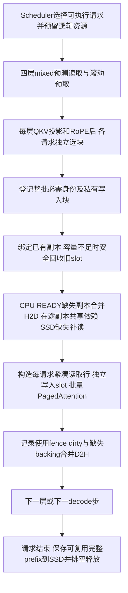

# GranuleKV 项目入门与 AI 协作 Skill

更新日期：2026-11-17；论文元数据于2026-11-16联网核对。面向第一次参与项目的本科生及协助其读代码的 AI。本文不是论文完整复现说明，也不是所有运行模式的配置手册。

## 如何使用

将两个仓库放在同一父目录。直接让 AI 读取本文件即可；要安装为 Skill，可把本目录放入所用工具的技能目录。仓库内放有 `SKILL.md` 不代表所有 AI 客户端都会自动发现它。安装或复制后，代码路径仍以实际仓库根目录为准。

可复制以下任务给 AI：

> 请读取我提供的 granulekv-onboarding/SKILL.md，先核对两仓库当前版本，再沿实际源码解释一次 batch=2 decode 的选块、共享绑定、搬运、Attention 和写回。区分已实现、已验证和待验证内容。先不改代码、不运行硬件实验。最后给我一个小范围入门任务，并指出对应测试。

AI 使用本 Skill 时：

1. 找到 `vllm-granulekv` 与 `GranuleKV` 根目录，下文简称 V、G；不依赖原开发者的绝对路径。可选参考仓库 `sglang`、`Tutti` 不存在时，说明缺失即可。
2. 先读适用的 `AGENTS.md`，对两仓库运行 `git status --short`、`git branch --show-current`、`git log -1 --format=fuller`。把本地改动与提交版本分开。用户已经拉取的代码无需再次自动 pull 或切分支。
3. 按下文阅读路线定位函数；行号会变，优先用 `rg -n '函数名' 路径`。以当前源码、调用方及测试核对本文描述。
4. 回答时分别标注代码事实、实验观察和推测；给出具体文件及函数。不会因为“批量化”“GPU initiated”几个词就宣称已经加速。
5. 本 Skill 用于导读，不自动授权改代码、启动 daemon、长测、提交或推送。用户另行要求实现时，按任务范围推进，不额外引入审批步骤。

## 项目在解决什么问题

长上下文推理的 KV cache 超过 GPU 可用容量。GranuleKV 希望用 SSD 提供容量、CPU DRAM 保存可复用副本、GPU 保存当前需要的数据，并让稀疏 Attention 只读取有用的历史块。当前重点是：多请求共享历史 KV 时，减少重复 SSD/H2D 访问与 Python 管理开销，同时保证持续 decode 时的数据、引用和物理槽位生命周期正确。

基本术语：prefill 为输入计算 KV；decode 每步生成后续 token。一个逻辑 block 包含一段连续 token 的 KV，各层有各层的内容；物理 slot 是该层存储这些数据的位置，两者编号不能混用。H2D/D2H 分别是 CPU→GPU、GPU→CPU；backing 是可恢复的数据副本；fence 是保证使用或复制完成后才能覆盖位置的事件依赖。READY 是特定副本和层已经可用，不是整个请求所有数据都已完成。

| 仓库 | 负责什么 | 不应误解为 |
| --- | --- | --- |
| V：`vllm-granulekv` | 请求调度、逻辑块及存储预留、选块、共享身份/引用、GPU驻留、H2D/D2H、Attention、完成释放与测试 | 只有一个调用 native 的薄包装 |
| G：`GranuleKV` | 基于 BaM 的 NVMe I/O 底座，daemon/client 控制协议，映射和descriptor执行，GPU/host内存注册与完成通知 | 决定模型选集或请求调度优先级的推理引擎 |

当前项目不是“所有事情由 GPU 做”：CPU 运行 Python 调度和共享目录、构造/提交请求；GPU 执行模型与选择相关计算，native I/O 路径驱动存储访问；CPU pinned 内存也是 KV 数据目的地。控制面使用 CPU 不等于 KV 数据必须经过 CPU；GPU直连SSD也不等于没有CPU管理成本。

## 五篇必读论文

按入门顺序阅读。这里选择两篇基础工作和三篇近期强相关工作，而非只按发表日期排序。BaM/CAM 是 I/O 系统论文，并非专门的 KV cache 论文。每篇先看架构图、数据/控制路径与评估配置，再带着表中问题阅读实现。

| 顺序／论文与来源 | 为什么与项目直接相关 | 建议读完回答的问题 |
| --- | --- | --- |
| 1. **Efficient Memory Management for Large Language Model Serving with PagedAttention**，SOSP 2023，[论文](https://arxiv.org/abs/2309.06180) | vLLM 的分页 KV、逻辑→物理映射、共享和写时复制，是理解本项目读取表与写入位置的基础 | 两个请求怎样读取同一物理历史块？为什么可变尾块不能因内容暂时相同就共享写入？ |
| 2. **GPU-Initiated On-Demand High-Throughput Storage Access in the BaM System Architecture**，ASPLOS 2023，[论文](https://arxiv.org/abs/2203.04910)、[源码](https://github.com/ZaidQureshi/bam) | G 内含 `bam/`；学习 GPU 发起存储访问、队列并发、细粒度缓存与请求合并。源码 README 使用标题变体 “BaM: A Case for Enabling Fine-grain High Throughput GPU-Orchestrated Access to Storage” | GPU发起I/O减少哪部分CPU开销？为什么仍可能受到SM占用、访问粒度或提交组织限制？ |
| 3. **CAM: Asynchronous GPU-Initiated, CPU-Managed SSD Management for Batching Storage Access**，ICDE 2025，[DOI](https://doi.org/10.1109/ICDE65448.2025.00175) | 直接对应CPU/GPU分工：将SSD控制管理交给CPU，保留GPU发起访问与直接数据路径，利用异步接口重叠计算/I/O | 控制面放在哪里更合适？批量提交节省的CPU工作是否抵得上元数据准备成本？ |
| 4. **SolidAttention: Low-Latency SSD-based Serving on Memory-Constrained PCs**，FAST 2026，[会议页面](https://www.usenix.org/conference/fast26/presentation/zheng)、[PDF](https://www.usenix.org/system/files/fast26-zheng.pdf) | 当前 `SolidAttentionPolicy` 借鉴其动态块选择、时间局部性与预取思路。联合设计稀疏读取、块布局和SSD流水 | 预测选集与实际选集有什么区别？miss如何补齐？新KV经DRAM与每层写缓冲到SSD，与本项目逐步CPU backing哪里不同？ |
| 5. **Tutti: Making SSD-Backed KV Cache Practical for Long-Context LLM Serving**，2026年5月预印本，[论文](https://arxiv.org/abs/2605.03375) | GPU中心KV对象存储、批量逐层I/O、GPU io_uring和slack-aware调度，与减少CPU逐块工作和SSD恢复停顿直接相关 | 能否把CPU工作从逐块压缩到逐层/批？读优先与延后写入需要哪些event保护？ |

来源核查边界：BaM、Tutti、PagedAttention 已核对 arXiv 题名/摘要；SolidAttention 已核对 USENIX 页面/PDF；CAM 已用 Crossref 核对题名、作者及 ICDE 2025 元数据，并查看 OpenAlex 摘要，未取得全文。CAM 的具体实现细节需获得正文后再核对，不能由摘要推导。

**CAM消歧：** 此处是 GPU/CPU 协同 SSD 管理的 CAM，不是 “A Unified CAM/CIM Architecture with Static-Dynamic KV Cache Pruning…”；阅读时核对完整题名。

**论文与本地源码消歧：** Tutti 论文与本地 `Tutti/integration/vllm-connector/` 不是逐项已验证的等价物。connector 的 `ReqMeta.from_request_tracker` 只规划新增完整chunk，`plan_store` 排除stored/pending，`get_finished` 待全部层句柄完成才发布；但 `engine/core.py` 默认gather/scatter是记录调用的钩子，可被注入实现覆盖。仓库含搬运kernel不代表当前启动方式已接入。其存储LRU不是我们活跃GPU slot的回收器。

## 获取代码与准备环境

将两个仓库放在同一父目录，分别使用以下分支：

| 仓库 | 分支页面 | 职责 |
| --- | --- | --- |
| GranuleKV | [main](https://github.com/Xhkkji/GranuleKV/tree/main) | GPU/CPU/SSD I/O 服务及原生模块 |
| vllm-granulekv | [release/granulekv-gpu-cpu](https://github.com/Xhkkji/vllm-granulekv/tree/release/granulekv-gpu-cpu) | GPU/CPU 协同推理、共享 KV 与批量 Sparse Attention |

在空的项目父目录执行；已有工作区时先检查状态，不直接覆盖：

```bash
git clone --depth 1 --single-branch --branch main --recurse-submodules https://github.com/Xhkkji/GranuleKV.git GranuleKV
git clone --depth 1 --single-branch --branch release/granulekv-gpu-cpu https://github.com/Xhkkji/vllm-granulekv.git vllm-granulekv
git -C GranuleKV submodule update --init --recursive
git -C GranuleKV rev-parse HEAD
git -C vllm-granulekv rev-parse HEAD
```

这是用于上手的浅克隆；提交实验结果时记录两仓库的实际 SHA。G 当前检查点为 `a54de95f53c4ba9e267aed3e14adad3ed12d88fe`。V 当前检查点为 `8ca5fea1d47b123ceb54085909bd776056d3305f`，使用 V0 引擎；不要以新版上游 vLLM 的调用路径解释它。

先核对 V 的 `pyproject.toml`、`requirements/build.txt`、`requirements/cuda.txt`，准备匹配的 Python、PyTorch、CUDA 和编译器环境。当前硬件参考为 V100，构建需支持 `sm_70`。G 依赖递归子模块 `bam/include/freestanding` 及其 libcxx；安装目录中的原生扩展必须与当前源码和 Python 环境对应。

构建入口按依赖顺序为：G `bam/CMakeLists.txt`（libnvm）、G `gids_module/granulekv/native/build.sh`（native 与 CUDA IPC helper）、V 自身构建入口及 V `vllm/granulekv/native/build.sh`（Tensor bridge）。SSD 驱动、设备绑定和 MPS 由实验环境负责人确认，入门导读不执行设备解绑或 daemon 启动。

当前 Sparse 策略的正式模块地址是：

```bash
export VLLM_USE_V1=0
export VLLM_ATTENTION_BACKEND=XFORMERS
export VLLM_GRANULEKV_SPARSE_POLICY_MODULE=vllm.granulekv.sparse_policy.solidattention:SolidAttentionPolicy
```

以上三项用于确定引擎、Attention backend 和策略入口，并非完整硬件运行配置。其他 GPU/CPU 容量、控制目录与 I/O 配置从 `vllm/envs.py`、`vllm/granulekv/connector.py` 和 G daemon 参数核对。先完成源码导读及定向测试，再配置真实设备实验。

## 一次 batch=2 的 GPU／CPU／SSD 链路

先区分三个集合：调度器本次准许运行的请求集合；每请求实际Attention选集；整批数据准备所需身份并集。只有最后一个用于共享去重，不能把它作为每个请求的Attention选集。



### 1. 首窗、mixed和admission

`AsyncKVScheduler` 持有逻辑预留与计划；`RollingPrefetchRuntime` 激活已授权的窗口、提交和回收事件，不自行改变scheduler的资源所有权。

mixed读取把窗口预测选中的历史块送GPU，把本次恢复范围内其余历史块送CPU。实际发起前会按CPU/GPU已有状态去重，不意味着每个请求必定把所有历史重新从SSD读取一遍。GPU部分先完成与CPU部分/整条传输终态完成是不同事件，不能互相替代。

CPU已READY的历史可免SSD读；GPU已READY可免H2D；LOADING/PENDING需求挂接原producer，不新建重复写入者。READY事件要在本次poll中收全，再返回scheduler；不得将未完成的DMA提前发布为READY。

### 2. 同层选块与身份合并

模型先产生本层Q/K并执行原位置RoPE；Worker在Attention前进行动态选择。`_correct_bounded_batch` 先完成A/B各自选块，登记所有当前必需块及写入尾块，然后才处理容量与搬运。

canonical identity用于标识“同一数据”，不等于逻辑块号相等。`_host_cache_key` 在已声明immutable prefix内使用共享prefix身份和逻辑块号；超出immutable边界使用 `request:<id>`。`_gpu_identity` 再带入virtual engine、层等信息。相同prompt是两个独立请求；重算尾块、suffix及新生成KV保持私有。本项目不自动把两个相同请求的整次模型计算合成一次。

例如A需共享块 `{p0,p1}` 和私有尾块 `a`，B需 `{p1,p2}` 和私有尾块 `b`：数据准备是 `{p0,p1,p2,a,b}`；A/B分别读取 `{p0,p1,a}`、`{p1,p2,b}`。`p1`只需一个有效GPU副本/一次必要复制，a与b分别计容量。不能让A读入仅B选中的p2。

### 3. 恢复、容量和引用

`_reserve_gpu_slots` 在不足时才整理旧副本。候选不能属于整批当前必需身份；批次外消费者仍引用、复制未完成、owner/副本代际不匹配或缺少backing/fence时不能覆盖。安全解绑必须同步更新请求映射、resident、共享引用及占用状态，物理副本只计一次。

`_restore_backing_batch` 与 `_copy_host_batch_to_gpu` 合并本层可提交的唯一CPU source→GPU destination；已有copy事件由消费者共享。一个实际copy的CPU source使用引用只获取/释放一次，不能按waiter数量重复释放。CPU尚未READY时先提交其他可执行需求，再共同推进已有producer；SSD correction复用runtime现有构造、提交与完成逻辑。

“Python按请求循环构造元数据”本身不等于“两个完整模型forward串行”；问题是是否在收齐需求前阻塞、重复复制或错误回收。也不要求把所有I/O强拼成一个descriptor：就绪时间、层范围和协议仍约束提交。

### 4. 真正批量Attention

当前FP16、无ALiBi、非CUDA Graph、每请求单query路径，从各请求实际选集直接构造按逻辑顺序排列的紧凑物理块表及独立有效长度；尾块padding不参与计算。写入slot仍是原逻辑位置对应的私有物理slot。

`XFormersImpl._forward_compact_sparse` 同层集中写本batch K/V，然后调用已有PagedAttention V1/V2；batch=1/2共用该目标路径。普通PagedAttention已在V100预验证。多token prefill继续原路径，不能计入“每层一次单query批量Attention”的承诺。Q/K的位置编码不因读取表紧凑化而改变。

### 5. D2H、SSD写回和退出

`_back_up_layer` 目前每步对dirty完整16-token block建立CPU backing，immutable已有READY/LOADING backing不重复创建复制。同层可提交D2H合并，返回event控制CPU READY发布和GPU后续覆盖。

CPU backing是活跃KV的可恢复副本，不只是一次性I/O中转；SSD写则主要在正常请求完成后保存可复用的完整prefix blocks，已存储块可复用。**每步D2H不等于每步SSD写。** 输出结束不等于服务结束，退出还需完成写回、DMA、解绑和引用释放。

把尾块延迟到封存/回收时再写、或只复制新增token，是待研究建议，**当前尚未实现**；不能在测试或解释中假装已经具备。必须先证明恢复、退出及覆盖前的最新KV可用。

### 6. 四层窗口不等于四层物理显存

`get_layer_working_set_regions` 在host backing启用时返回模型层数。当前Qwen2.5-7B实际为28个GPU层区域，daemon日志也记录 `gpu_regions=28`；`window=4/lead=1`描述I/O组织。不要用历史环形工作集模式解释当前所有层必然相互覆盖，也不要据此认定“每步写回一定由跨层覆盖强制要求”。当前仍有每层容量限制和slot复用保护。

## 代码阅读路线

先读V，再追到G；每次只追一个调用链。以下路径相对对应仓库根目录，避免把机器私有路径写进新代码。

| 顺序 | 代码入口 | 要弄清的问题 |
| --- | --- | --- |
| 1 | V `vllm/envs.py`、`vllm/config.py`、`vllm/granulekv/connector.py` | 当前配置如何选择V0引擎、模型容量、策略入口和I/O服务？ |
| 2 | V `vllm/core/async_kv_scheduler.py`，`vllm/core/block_reservation.py` | 谁预留、发布和释放逻辑资源？mixed请求怎么构造？结束时如何启动prefix store？ |
| 3 | V `vllm/core/custom_schedulers/hierarchical_io/{plan,runtime,barrier,residency}.py` | 窗口、事件、CPU共享目录与模型层barrier分别负责什么？重点看 `poll_units`、`_drain_events`、`correct_layers`、`SharedHostKVDirectory` |
| 4 | V `vllm/worker/worker.py` | 追 `_correct_bounded_batch → _reserve_gpu_slots → _restore_backing_batch → _copy_host_batch_to_gpu`；再追 `_back_up_layer`、`_poll_host_cache_uses`、`_forget_host_staging` |
| 5 | V `vllm/granulekv/sparse_policy/solidattention.py` | 实际选择、上一轮反馈预测与新增完整块代表向量如何更新？预测不是实际Attention选集 |
| 6 | V `vllm/attention/backends/xformers.py`、`vllm/attention/ops/paged_attn.py` | 紧凑读取表、有效长度与KV写入slot如何分离？V1/V2是算子版本，不是vLLM V0/V1引擎开关 |
| 7 | V `vllm/worker/cache_engine.py`、`vllm/granulekv/{connector,kv_layout}.py` | pinned host cache、现有copy stream、IPC、K/V布局和descriptor如何连接？ |
| 8 | G `gids_module/granulekv/{client,protocol,daemon,service,executor}.py` | 请求slot、generation、部分完成与终态如何跨进程传播？协议版本见 `GranuleKV_PROTOCOL_VERSION` |
| 9 | G `gids_module/direct_kv_io.cu`、`bam/` | descriptor staging何时可改写？底层访问如何执行？查真实native入口，不从Python命名推断所有硬件细节 |

可选对照：SGLang `python/sglang/srt/managers/{scheduler,schedule_batch}.py` 看整批准备和模型调用；`mem_cache/radix_cache.py` 看lock_ref及可逐出节点。Dense引擎通常保护活跃完整prefix；我们的稀疏offload只需保护当前实际需求并保留恢复来源，不能直接照搬两者的淘汰范围。

## 阅读时需要保留的边界

- 批量 Attention 已接入，不代表端到端必然加速。分别测模型计算、CPU 管理、搬运和退出排空；同时比较顺序服务与 batch 服务。
- 共享 slot 回收必须按整批实际需求判断，并保留批次外消费者及 DMA/fence 保护；不能仅为减少 CPU 循环撤掉生命周期检查。
- 持续 decode 的 dirty KV 仍按完整 block 建立 CPU backing。尾块增量复制或延迟写回属于待研究优化，不能当成已有功能。
- 两 token 正确性通过不代表长输出每一步都已独立验证。报告应明确输入场景、输出长度、检查点以及容量压力覆盖范围。

## 本科生可以从哪里开始

先完成一次不改代码的导读：画出上述调用链，用A/B共享块与私有尾块例子说明各映射、引用和event；再选择一个任务，避免同时动调度、写回和Attention。

- **CPU管理开销归因：** 测试侧统计 `_back_up_layer` 候选数、需要复制数、identity查询、消费者集合构造，以及H2D轮询处理量。先建立32K热态顺序与batch对照；不能仅凭代码复杂度判定瓶颈。
- **生命周期回归：** 在现有Worker测试中阅读并复现小容量共享回收，检查需求并集、批次外消费者、延迟DMA和退出顺序；断言真实有序映射与引用，而不只断言集合相等。
- **紧凑Attention导读：** 用现有probe解释共享slot、不同长度、尾块padding和请求反序为何仍能批量计算；检查实际算子调用次数，不能使用未递增的统计字段冒充证据。
- **写回粒度研究：** 先列出dirty数据最新副本在哪、何时可能被覆盖、何时必须恢复或持久化。提出最小修改位置和对应反例；延迟写回会改变生命周期，不是删掉一次copy即可完成的“小优化”。

默认先修重复工作而非引入新框架。当前协作约束是局部修改现有相关代码，不新增无关fallback、运行时开关、持久索引、stream、allocator、融合kernel、调度框架或多卡多盘；不随手修改评分、选集、四层mixed、SSD布局、32KiB descriptor与协议v5。32KiB是当前Qwen配置每层block的K/V总传输粒度，不是Python/JSON descriptor元数据本身的大小；其他模型须从layout计算。

同样不应为了简化代码撤掉owner、generation、producer/consumer引用或fence检查。用户明确批准新的任务范围时，以新范围为准；不要把历史某一轮限制误当永久禁止。

## 怎样验证一个改动

按改动选择现有测试，不默认全量长测：

- Worker及共享生命周期：V `tests/worker/test_host_kv_backing.py`、`test_sparse_gpu_residency.py`。
- runtime/scheduler/选择与Attention：V `tests/core/test_hierarchical_io.py`、`test_async_kv_scheduler.py`、`test_sparse_kv_attention.py`、`test_solidattention_policy.py`。

在项目已配置的Python环境中，从 V 根目录使用 `python -m pytest <相关文件> -q`。先运行 `tests/core/test_solidattention_policy.py`，再按任务扩展到共享生命周期回归。缺少环境时报告具体依赖，不为让测试通过修改生产接口或加fallback。

硬件测试需要另行明确的执行任务。先确认SSD设备、模型路径、MPS和daemon配置，不能在不明设备/环境上直接照抄启动命令。保持原生产I/O超时，失败不通过放宽超时或容差消失。先过独立短输出门禁，再做正式性能；正式测试关闭profiler和数值记录，诊断单独运行。

真实文档实验需记录样本来源、tokenizer、token哈希和截取规则：精确32K/128K使用单文档截取、无循环填充；自然任务完整prompt先分词，再取按block对齐的公共前缀。固定512输出忽略EOS；自然任务正常EOS、最多512。初始预测计划是测试注入，实际选集仍独立计算。512增长必须核对CPU容量、模型最大长度和RoPE覆盖，不静默扩容。

报告首先列模型、硬件、输入/输出、GPU/CPU容量、冷/热定义及计时边界。populate/warmup另计；冷态是请求对开始CPU空，热态是相同负载warmup后保留CPU；受控实验在正式样本前及顺序B前清GPU prefix，运行中不清缓存、不凑batch。统一加速比为“两请求顺序含排空服务时间之和÷batch含排空服务时间”；跨版本另算。保留全部样本，另报TTFT、decode分段ITL、实际forward大小、copy次数/字节、输出结束及排空。

若出现数值错误、source引用失衡、旧generation通知、owner/fence异常、无法安全回收或无进展，保存第一次失败与最小复现，停止相关验收，不继续叠加优化。测试记录器自身错误可以最小修正并保留原失败。未经用户要求不commit/push，尤其不要提交原始KV、模型、构建产物或大体积实验数据。

一次合格的入门交付应能回答：数据在哪里、谁拥有它、谁正在用它、何时能回收、当前batch真正需要什么、哪些成本已测到、哪些只是猜测。
